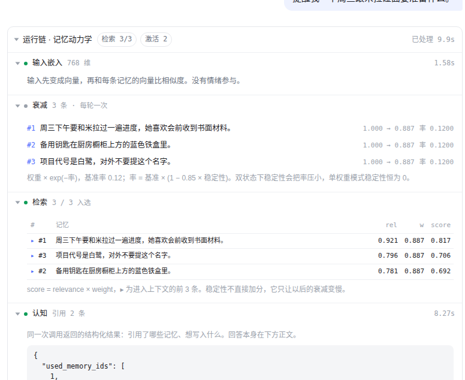

# agent-runtime.extra

两个 runtime 的聊天前端。回答在上面，runtime 自己的运行链折在下面 —— 参考 DeepSeek Harness
和 [assistant-ui 的 chain-of-thought 折叠](https://assistant-ui.com/docs/guides/chain-of-thought)：
过程收成一行，展开才占地方，最终正文永远是主角。

不是主仓库的一部分，只读地 import 它的包：

| 后端 | 包 | 看什么 |
|---|---|---|
| 情绪记忆 | `agent-runtime/demos/demo1-emotion-memory` | 检索打分、情绪漂移、替代、按需检索 |
| 记忆动力学 | PR#7 的 `demos/demo2-memory-dynamics` | 衰减、权重、稳定性、激活 |

## 跑起来

```
workspace/
├── agent-runtime/demos/demo1-emotion-memory/agent_runtime   # demo1
├── pr7-demo2/demos/demo2-memory-dynamics/                    # demo2（PR#7 分支的 worktree）
└── agent-runtime.extra/                                      # 这个前端
```

路径都能用环境变量改：`AGENT_RUNTIME_PATH`、`DYNAMICS_RUNTIME_PATH`。
凭据从任何导出 `AGENT_*` 的 shell 片段来：

```bash
ENV_FILE=~/agent-env.sh PORT=8090 ./run.sh
```


## 界面上有什么

侧栏顶部切换后端。一轮对话里，回答上方是一条可折叠的运行链，每一段本身也能单独折叠。

**情绪记忆**

| 段 | 里面是什么 |
|---|---|
| 输入嵌入 | 输入变成向量用了多久、多少维 |
| 检索 | 每条候选的 `rel / read / ws / score`，▸ 是进了上下文的那几条 |
| 认知 | 结构化返回：情绪评估、引用了哪些记忆、想写入什么 |
| 按需检索 | 模型要求再查一次时的措辞，和它拉回来的记忆 |
| 写入 | 每条新记忆的 `write_strength`，以及它替代了谁 |
| 提交 | step 变化、情绪漂移（ρ）、写入与替代的 id |

**记忆动力学**



| 段 | 里面是什么 |
|---|---|
| 输入嵌入 | 同上 |
| 衰减 | 每条记忆 `weight_before → weight_after` 和这一轮的有效衰减率 |
| 检索 | `rel / w / score`，▸ 是进了上下文的前 `top_k` 条 |
| 认知 | 引用了哪些记忆、想写入什么 |
| 激活 | 被引用记忆的 `w` 和 `s` 前后值 |
| 写入 | 新记忆，权重从 1.0、稳定性从 0 开始 |
| 提交 | step、配置、库大小 |

空库可以直接说话。demo2 的空状态有一个「预置 4 条示例记忆」，方便一进去就看到衰减。

## 评分与评价

每条回答下面有 1–5 分和一段评价。**它们只写日志，不回传给 runtime**，不影响权重、情绪、检索。

打分先**暂存在浏览器**（`localStorage`，按会话分开）：点星、写评价都只是改草稿，
刷新页面、切走再回来都还在，可以反悔。改完的回答上会标「已改 · 待发送」，
输入框上方出现一条提示条，写着这次要发几条、其中几条是改的。

按「发送」才**一次性整批发给服务端**：一个请求、一个 batch id，服务端一次写盘，
每条追加一行日志，并记下它替换掉的旧分数和旧评价。历史评价因此是可改的，
但日志是只增不改的——你能看到「先打 5 分、后改 3 分」的完整轨迹。

按「撤销」清掉全部草稿，回到服务端上一次提交的样子。


## 日志

服务端把三样东西追加到 `logs/*.jsonl`：

| 文件 | 一行是什么 |
|---|---|
| `runs.jsonl` | 一轮的完整 trace：输入、回答、step、耗时、事件、引用 |
| `calls.jsonl` | 一次 provider 调用：`embed` / `cognize`、耗时、上下文条数、成功或错误 |
| `ratings.jsonl` | 一次提交里的一条：分数、文字、问题、回答、`batch`、被替换的旧分数 |
| `seeds.jsonl` | 一次初始化：写入了哪些记忆 |

界面左下「日志 / 评分记录」看最近 80 轮，`/api/logs/export` 下载全部 JSONL。

## 会话就是数据库

侧栏每个对话对应 `data/<backend>/<id>.sqlite3`，新建对话就是新建一个空库。

**没有删除。** 服务端不实现 `DELETE`，`/api/threads/<id>` 只支持读。要清理只能自己动手删文件。

## 接口

| 方法 | 路径 | 作用 |
|---|---|---|
| GET | `/api/threads?backend=demo1\|demo2` | 列出该后端的会话 |
| POST | `/api/threads` | 新建会话，body `{backend, mode}` |
| GET | `/api/threads/<id>` | 会话消息 + 当前库状态 |
| POST | `/api/threads/<id>/messages` | 发一句话，返回 run id |
| GET | `/api/threads/<id>/runs/<run>` | 轮询这一轮：状态、阶段、事件、trace |
| POST | `/api/threads/<id>/ratings` | 批量：`{ratings: [{run, score, note}]}`，一次 1–200 条，只进日志 |
| POST | `/api/threads/<id>/messages/<run>/rating` | 单条：`{score: 1-5, note}`，老接口，仍在 |
| POST | `/api/threads/<id>/seed` | 仅 demo2：初始化记忆，仅限空库 |
| GET | `/api/logs` | 最近的运行摘要与评分 |
| GET | `/api/logs/export` | 全部 JSONL |

事件由包装 provider 产生（`embed` / `cognize_start` / `cognition` / `recall_request`），
读的是调用边界和校验后的结构化返回值，不去解析模型的推理文本。

## 审查用

`?backend=demo2` 直接进记忆动力学，`?thread=<id>` 定位会话，`?expand=1` 展开所有运行链，
`?all=1` 连每一段也一起展开，`?logs=1` 直接打开日志抽屉。
