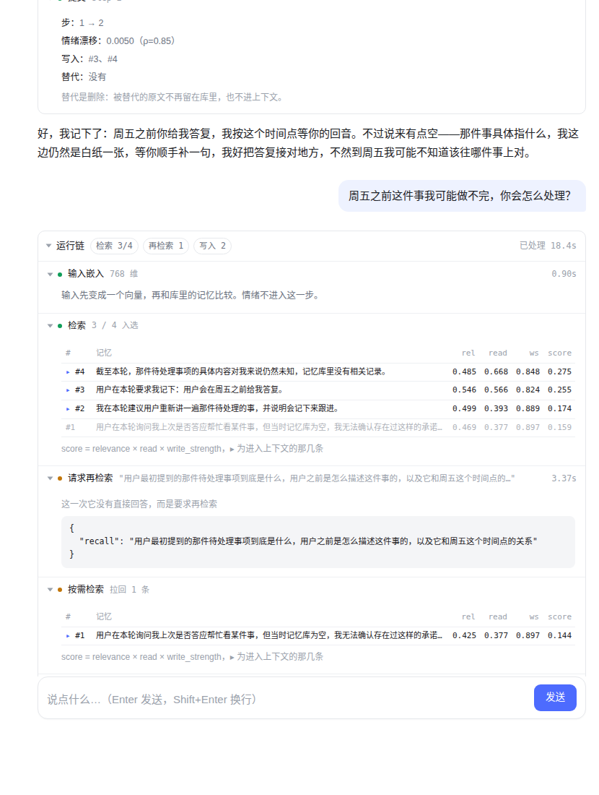

# agent-runtime.extra

`agent-runtime` demo 的一个聊天前端。回答在上面，runtime 自己的运行链折在下面 —— 参考 DeepSeek Harness
和 [assistant-ui 的 chain-of-thought 折叠](https://assistant-ui.com/docs/guides/chain-of-thought)：
过程收成一行，展开才占地方，最终正文永远是主角。

不是主仓库的一部分，只读地 import 它的 `agent_runtime` 包。

## 跑起来

`agent-runtime` 放在同级目录（或用 `AGENT_RUNTIME_PATH` 指过去）：

```
workspace/
├── agent-runtime/demos/demo1-emotion-memory/agent_runtime   # 被 import 的运行时
└── agent-runtime.extra/                                     # 这个前端
```

凭据从任何导出 `AGENT_*` 的 shell 片段来：

```bash
ENV_FILE=~/agent-env.sh PORT=8090 ./run.sh
```

打开 `http://127.0.0.1:8090`。



## 界面上有什么

一轮对话里，回答上方是一条可折叠的运行链，每一段本身也能单独折叠：

| 段 | 里面是什么 |
|---|---|
| 输入嵌入 | 输入变成向量用了多久、多少维 |
| 检索 | 库里的每条候选与它的 `rel / read / ws / score`，▸ 是进了上下文的那几条 |
| 认知 | 模型这次返回的结构化结果：情绪评估、引用了哪些记忆、想写入什么 |
| 按需检索 | 模型自己要求再查一次时的措辞，和它拉回来的记忆 |
| 写入 | 每条新记忆的 `write_strength`，以及它替代了谁 |
| 提交 | step 变化、情绪漂移（ρ）、写入与替代的 id |

运行中这条链是展开的，标题上带当前阶段和计时；提交后收成一行 `运行链 · 检索 3/4 · 写入 1 · 已处理 12.4s`。

正文是纯文本，不做 Markdown 渲染 —— 这个 runtime 的 `answer` 是给对话用的，不是给排版用的。

## 会话就是数据库

侧栏每个对话对应 `data/<id>.sqlite3`，新建对话就是新建一个空库（没有预置记忆，第一轮真的从零开始）。

**没有删除。** 服务端不实现 `DELETE`，`/api/threads/<id>` 只支持读。要清理只能自己动手删文件。

## 接口

| 方法 | 路径 | 作用 |
|---|---|---|
| GET | `/api/threads` | 列出会话 |
| POST | `/api/threads` | 新建会话（新库） |
| GET | `/api/threads/<id>` | 会话消息 + 当前库状态 |
| POST | `/api/threads/<id>/messages` | 发一句话，返回 run id |
| GET | `/api/threads/<id>/runs/<run>` | 轮询这一轮：状态、当前阶段、事件、trace |

事件由包装 provider 产生（`embed` / `cognize_start` / `cognition` / `recall_request`），
读的是调用边界和校验后的结构化返回值，不去解析模型的推理文本。

## 审查用

`?expand=1` 展开所有运行链，`?all=1` 连每一段也一起展开。
